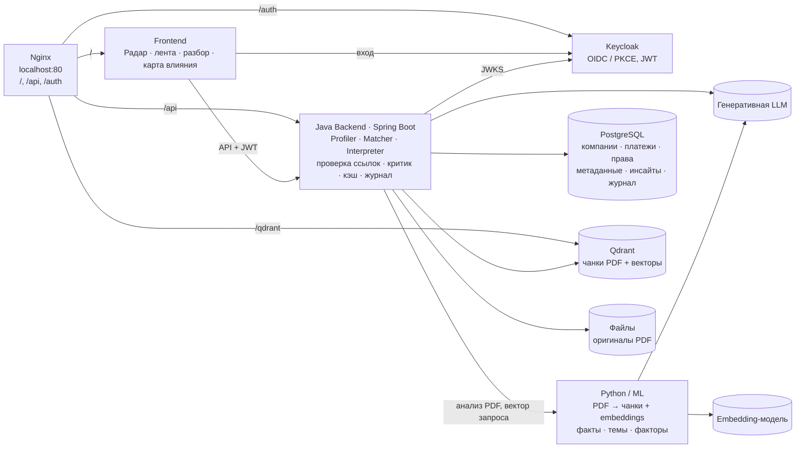

# Alfa Business Insights

**Персональная карта влияния событий на бизнес клиента и его контрагентов.**
Прототип команды для кейса «Новостная аналитика для принятия бизнес-решений» (Альфа-Банк × Changellenge).


---

## Содержание

- [Проблема](#проблема)
- [Решение](#решение)
- [Быстрый старт](#быстрый-старт)
- [Архитектура](#архитектура)
- [Структура репозитория](#структура-репозитория)
- [Статус и дорожная карта](#статус-и-дорожная-карта)
- [Команда](#команда)
- [Документация](#документация)

---

## Проблема

Руководителю крупного бизнеса не нужна ещё одна новостная лента. У компании с выручкой от 15 млрд ₽ уже есть своя аналитика, а решения зависят от ставки, курса, цен на сырьё, регулирования и состояния контрагентов. Вопрос, на который не отвечают агрегаторы: **«что это событие значит именно для нас?»**

Типовые решения фильтруют новости по отрасли. Это легко повторить и это не учитывает влияние второго порядка: через поставщиков, покупателей и группу компаний.

## Решение

Сервис внутри оболочки Альфа-Бизнес, который:

- **Отбирает события по признакам конкретной компании**, а не по отрасли: кредитная нагрузка, ВЭД, регион, продукты банка, топ-контрагенты по платёжному графу, группа компаний.
- **Объясняет влияние тремя раздельными слоями**: подтверждённые факты, позиция Альфа-Банка (из аналитики ЦМИ), выводы AI с уровнем уверенности.
- **Привязывает каждый вывод к источнику**: новость или фрагмент отчёта банка с номером страницы. Нет источника, значит это помечено как вывод AI.

Подробно: [Vision and Scope](doc/visionandscope.md).

---

## Быстрый старт

Нужны Docker и Docker Compose. Из корня проекта:

```bash
docker compose -f infrastructure/docker-compose.yaml up -d --build
```

После запуска сервисы доступны через nginx:

| Сервис | Адрес |
| --- | --- |
| Frontend | [http://localhost](http://localhost) |
| Backend API | [http://localhost/api](http://localhost/api) |
| Keycloak | [http://localhost/auth](http://localhost/auth) |
| Qdrant Dashboard | [http://localhost/qdrant/dashboard](http://localhost/qdrant/dashboard) |
| OpenAPI / Swagger UI | [http://localhost/api/swagger-ui.html](http://localhost/api/swagger-ui.html) |

Сейчас frontend отдаёт стартовую заглушку; интерфейс приложения ещё разрабатывается.

Остановить и удалить данные:

```bash
docker compose -f infrastructure/docker-compose.yaml down -v
```
---

## Архитектура




| Задача | Компонент | Модель |
| --- | --- | --- |
| Извлечение фактов, тем и факторов из материалов | Python / ML | Gemma 4 26B A4B |
| Векторы фрагментов и запросов | Python / ML | Embedding-модель (согласуется) |
| Инсайты, подробный разбор, критик | Java Backend | GLM-5.3-Flash |
| Уточняющие вопросы | Java Backend | Qwen3.6 35B A3B |
| Спорные случаи ранжирования | Java Backend | DeepSeek-V4.1-Flash (опционально) |


## Структура репозитория

```
.
├── backend/core/          
│   ├── src/main/java/alpha/business/insight/core/
│   │   ├── controller/    
│   │   ├── service/       
│   │   ├── ml/            
│   │   ├── model/         
│   │   └── migration/     
│   └── src/main/resources/
│       ├── data/csv/      
│       └── db/changelog/  
├── ml/                    
├── frontend/              
├── infrastructure/
│   ├── docker-compose.yaml
│   └── keycloak/          
├── doc/                   
├── tests/                 
└── .env.example           
```

---

## Статус и дорожная карта
 Легенда: ✅ готово · 🔄 в работе · ⬜ запланировано.

| | Возможность |
| --- | --- |
| ✅ | Docker Compose: nginx, frontend, backend, ML, PostgreSQL, Keycloak и Qdrant с healthchecks |
| ✅ | Вход через Keycloak, проверка JWT, роли, тестовые пользователи |
| ✅ | Импорт трёх CSV кейса при старте |
| ✅ | Контекст компании: профиль, группа, топ-контрагенты, концентрация платежей |
| ✅ | Загрузка PDF, хранение оригинала, индексация чанков в Qdrant (через заглушку ML) |
| ✅ | Схема БД для событий, инсайтов, шагов анализа, диалогов и обратной связи |
| 🔄 | Python ML-сервис: чтение PDF, чанки, настоящие embeddings |
| 🔄 | Frontend: оболочка, виджет «Радар», лента, разбор |
| ⬜ | Векторизация поисковых запросов, обработка событий (новость, URL, RSS) |
| ⬜ | Ранжирование по признакам и платёжному графу |
| ⬜ | Агентный цикл: план → инструменты → критик → доработка, трассировка |
| ⬜ | Подробный разбор по шести вопросам, уточняющие вопросы, кэш |
| ⬜ | Карта влияния, рекомендации с продуктом банка, 👍/👎 |
| ⬜ | Деплой на внешний сервер, THIRD_PARTY_NOTICES |

Трассировка возможностей к 12 критериям кейса: [Vision and Scope, раздел 5](doc/visionandscope.md#5-трассировка-к-критериям-кейса).

## Команда

| Роль | Зона ответственности |
| --- | --- |
| Java / AI / инфраструктура | API, PostgreSQL и Qdrant, оркестрация анализа, LLM, кэш, журналирование, Docker Compose, деплой |
| ML-инженер | PDF и новости: чтение, очистка, чанки, embeddings, факты, темы, факторы |
| Frontend / UI/UX | Оболочка, виджет «Радар», лента, разбор, карта влияния, диалог |
| QA | Контракты, сквозной сценарий, персонализация, отказы компонентов |
| Продакт | Сценарии, контракты данных, приёмка, метрики, README, демо |

## Документация

- [Vision and Scope](doc/visionandscope.md): бизнес-контекст, возможности, архитектура, границы MVP, критерии кейса.
- [Инструкция ML-разработчику](ml/ml-document-contract.md): контракт PDF → чанки, подключение к backend, критерии приёмки.
- [Frontend](http://localhost) (после запуска стенда).
- [OpenAPI / Swagger UI](http://localhost/api/swagger-ui.html) (после запуска стенда).
- [Keycloak](http://localhost/auth) (после запуска стенда).
