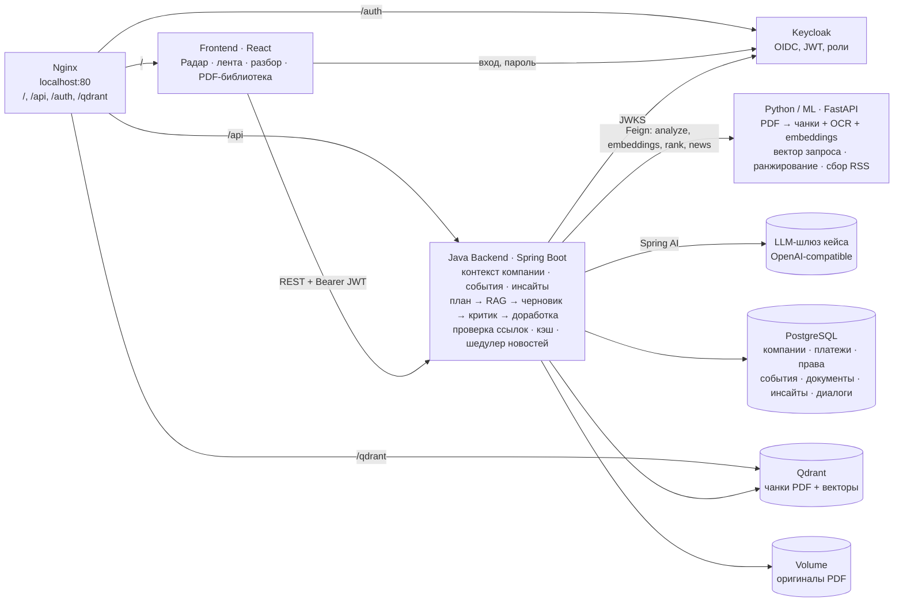

# Alfa Business Insights - команда "Орлы"

**Персональная карта влияния событий на бизнес клиента и его контрагентов.**
Прототип команды для кейса «Новостная аналитика для принятия бизнес-решений» (Альфа-Банк × Changellenge).


---

## Содержание

- [Назначение решения](#назначение-решения)
- [Архитектура](#архитектура)
- [Используемые компоненты](#используемые-компоненты)
- [Требования к окружению](#требования-к-окружению)
- [Запуск](#запуск)
- [Конфигурация и переменные окружения](#конфигурация-и-переменные-окружения)
- [API](#api)
- [Пошаговый сценарий проверки](#пошаговый-сценарий-проверки)
- [Тесты](#тесты)
- [Структура репозитория](#структура-репозитория)

---

## Назначение решения

Руководителю крупного бизнеса не нужна ещё одна новостная лента. У компании с выручкой от 15 млрд ₽ уже есть своя аналитика, а решения зависят от ставки, курса, цен на сырьё, регулирования и состояния контрагентов. Вопрос, на который не отвечают агрегаторы: **«что это событие значит именно для нас?»**

Сервис внутри оболочки Альфа-Бизнес, который:

- **Отбирает события по признакам конкретной компании**, а не по отрасли: ОКВЭД, кредитная нагрузка, ВЭД, регион, продукты банка, топ-контрагенты по платёжному графу, группа компаний.
- **Объясняет влияние тремя раздельными слоями**: подтверждённые факты, позиция Альфа-Банка (из загруженной аналитики), выводы AI с уровнем уверенности.
- **Привязывает каждый вывод к источнику**: новость или фрагмент PDF банка с номером страницы. Ссылки на фрагменты проверяются на стороне Java; нет источника, значит это помечено как вывод AI.

Что делает система в текущей версии:

1. Импортирует при старте три CSV кейса (компании, связи, платежи) в PostgreSQL.
2. Собирает новости из RSS по расписанию (Банк России, Интерфакс, ТАСС, РБК, Коммерсантъ) и сохраняет их как события.
3. Принимает PDF аналитики банка от администратора, читает их (с OCR для сканов), режет на чанки, считает embeddings и индексирует в Qdrant.
4. Для выбранной компании ранжирует события по факторам, отрасли, контрагентам и смысловой похожести и показывает топ-3 в виджете «Радар».
5. По запросу строит персональный инсайт: план поиска → RAG по Qdrant → черновик → критик → доработка → проверка ссылок → сохранение и кэш.

Подробно: [Vision and Scope](doc/visionandscope.md).

Снимок экрана с примером работы:

---

## Архитектура



Принципы: Java Backend единственный пишет в хранилища и оркестрирует анализ. Python готовит материалы и возвращает результат Java, в хранилища не пишет. Keycloak выдаёт токены, Java проверяет подпись по JWKS и право пользователя на компанию. Внешние тексты (новости, PDF) передаются в LLM только как данные.

**Поток инсайта** (`POST /api/companies/{id}/events/{eventId}/insight`):

1. Проверка доступа к компании, поиск кэша по паре компания + событие + версия материалов.
2. LLM `plan`: до трёх поисковых запросов.
3. ML `/embeddings` для каждого запроса → поиск в Qdrant с порогом `QDRANT_MIN_SCORE` → фильтрация чанков по документам в PostgreSQL.
4. LLM `draft` → LLM `critic` → при `complete=false` LLM `revision`. Не более четырёх вызовов LLM.
5. Валидация: ссылки `fragment_id` только на реально найденные фрагменты, `bank_view` только для настоящих PDF банка.
6. Сохранение инсайта и диалога; повторный POST возвращает сохранённый результат.

**Поток ранжирования** (`GET /api/companies/{id}/events/top`): Java собирает профиль компании и до 100 готовых событий → ML `/rank` считает релевантность × важность × свежесть по словарю факторов, ОКВЭД, контрагентам, странам ВЭД и региону, объясняя каждый вклад → если `/rank` вернул ошибку, откат на сравнение embeddings `/embeddings/compare`; при `ML_STUB=true` ранжирование лексическое.

---

## Используемые компоненты

| Компонент | Технология | Назначение |
| --- | --- | --- |
| `nginx` | nginx:alpine | Единая точка входа `:80`; маршруты `/`, `/api`, `/auth`, `/qdrant`; лимит тела 51 МБ, таймаут `/api` 420 с |
| `frontend` | React 18, TypeScript, Vite 5, `@alfalab/core-components`, pdfjs | Вход, выбор компании, главная с виджетом «Радар», лента событий, разбор инсайта, библиотека PDF |
| `backend` | Java 21, Spring Boot 4.1, Spring Security OAuth2 Resource Server, Spring Data JPA, Liquibase, Spring Cloud OpenFeign, Spring AI (OpenAI starter), springdoc | REST API `/api`, импорт CSV, контекст компании, события, инсайты, ранжирование, шедулер новостей |
| `ml` | Python 3.12, FastAPI, Uvicorn, PyMuPDF, Tesseract OCR (rus+eng), fastembed, feedparser, trafilatura, httpx | `/documents/{id}/analyze`, `/embeddings`, `/embeddings/compare`, `/rank`, `/news/collect`, `/health` |
| `postgres` | PostgreSQL 18 | Компании, связи, платёжные итоги, права доступа, события, метаданные документов, инсайты, диалоги |
| `qdrant` | Qdrant 1.19 (gRPC 6334, REST 6333) | Коллекция `rag_documents` (Cosine, 384) для настоящих embeddings; `knowledge_documents_stub_v1` (8) для заглушки |
| `keycloak` | Keycloak 26.8 | Realm `alfa-business-insights`, public-клиент `alfa-backend`: frontend входит по логину и паролю (password grant), Swagger UI через PKCE; роли `SYSTEM_ADMIN` и `COMPANY_DIRECTOR` |
| LLM | OpenAI-compatible шлюз кейса, модель `z-ai/glm-5.3-flash` | Стадии `plan`, `draft`, `critic`, `revision`; JSON-ответ, без автоповторов |
| Embeddings | `intfloat/multilingual-e5-small` через fastembed (ONNX, CPU) | Векторы чанков PDF (`passage:`) и поисковых запросов (`query:`), размерность 384 |

Лицензии и источники данных: [THIRD_PARTY_NOTICES.md](THIRD_PARTY_NOTICES.md).

---

## Требования к окружению

**Для запуска стенда (Docker):**

- Docker Engine с Docker Compose v2 в режиме Linux-контейнеров.
- Свободные порты `80`, `3000`, `5432`, `6333`, `6334`, `8000`, `8080`.
- Рекомендуется не менее 8 ГБ ОЗУ для контейнеров: Keycloak ограничен 1 ГБ, ML держит ONNX-модель e5-small в памяти и при первом старте скачивает её с Hugging Face.
- Доступ в интернет при первой сборке: образы, Maven-зависимости, npm, pip, модель embeddings. Для генерации инсайтов нужен доступ к LLM-шлюзу кейса и ключ `LLM_API_KEY`; для сбора новостей нужен доступ к RSS-источникам.

**Для локальной разработки и тестов без Docker-сборки:**

| Часть | Требования |
| --- | --- |
| Backend | Java 21, Maven 3.9+ (или `backend/core/mvnw`), Docker для Testcontainers в интеграционных тестах |
| ML | Python 3.11+, `pip`, Tesseract OCR с языками `rus` и `eng` для OCR-тестов |
| Frontend | Node.js 22, npm |

---

## Запуск

### Docker Compose (основной способ)

Compose читает переменные из `.env.example` напрямую, поэтому файл `.env` создавать не обязательно.

**Ключ LLM.** Ключ LLM-шлюза кейса уже задан в `.env.example` (`LLM_API_KEY`), это ключ команды «Орлы». Организаторы активируют его на время проверки. Чтобы использовать свой ключ, замените значение `LLM_API_KEY` в `.env.example` или задайте его в shell перед запуском, переменная окружения имеет приоритет:

```bash
export LLM_API_KEY=<ваш ключ>
```

Из корня репозитория:

```bash
docker compose -f infrastructure/docker-compose.yaml up -d --build
```

Первый запуск занимает несколько минут: Maven собирает backend, npm собирает frontend, pip ставит зависимости ML, затем ML скачивает модель embeddings. Проверить, что все сервисы `healthy`:

```bash
docker compose -f infrastructure/docker-compose.yaml ps
```

После запуска доступны через nginx:

| Сервис | Адрес |
| --- | --- |
| Frontend | [http://localhost](http://localhost) |
| Backend API | [http://localhost/api](http://localhost/api) |
| OpenAPI / Swagger UI | [http://localhost/api/swagger-ui.html](http://localhost/api/swagger-ui.html) |
| Keycloak (admin `admin` / `admin-dev`) | [http://localhost/auth](http://localhost/auth) |
| Qdrant Dashboard | [http://localhost/qdrant/dashboard](http://localhost/qdrant/dashboard) |
| ML-сервис (напрямую) | [http://localhost:8000/docs](http://localhost:8000/docs) |

Тестовые пользователи realm (импортируются из `infrastructure/keycloak/`):

| Логин | Пароль | Роль | Что может |
| --- | --- | --- | --- |
| `sysadmin` | `sysadmin-dev` | `SYSTEM_ADMIN` | Все компании, загрузка и удаление PDF, создание событий |
| `director` | `director-dev` | `COMPANY_DIRECTOR` | Только компании, выданные в таблице `user_company_access` (по умолчанию пусто) |

Логи и остановка:

```bash
docker compose -f infrastructure/docker-compose.yaml logs -f backend ml
```

```bash
docker compose -f infrastructure/docker-compose.yaml down -v
```

`down -v` удаляет тома: базу, realm Keycloak, коллекции Qdrant и загруженные PDF.

### Локальная разработка отдельных частей

Поднимите инфраструктуру в Docker (`postgres`, `keycloak`, `qdrant`, `ml`, `nginx`), затем запускайте нужную часть на хосте.

Backend (нужны переменные из `.env.example` в окружении; `SPRING_DATASOURCE_URL` и `ML_URL` поменяйте на `localhost`):

```bash
cd backend/core && ./mvnw spring-boot:run
```

ML:

```bash
cd ml && python -m venv .venv && source .venv/bin/activate && pip install -r requirements.txt && uvicorn app.main:app --port 8000
```

Frontend (Vite на `:3000`, `/api` проксируется в Spring `:8080`, `/auth` через nginx `:80`):

```bash
cd frontend && npm ci && npm run dev
```

---

## Конфигурация и переменные окружения

Все переменные перечислены в [`.env.example`](.env.example). Compose передаёт файл целиком в `postgres`, `keycloak`, `ml` и `backend`.

### Backend (Java)

| Переменная | По умолчанию | Назначение |
| --- | --- | --- |
| `SPRING_DATASOURCE_URL` | `jdbc:postgresql://postgres:5432/alfadb` | JDBC-адрес PostgreSQL |
| `POSTGRES_USER` / `POSTGRES_PASSWORD` | `alfa_user` / `alfa_password` | Учётные данные БД (те же использует контейнер `postgres`) |
| `SERVER_PORT` | `8080` | Порт Spring; context-path фиксирован `/api` |
| `KEYCLOAK_ISSUER_URI` | `http://localhost/auth/realms/alfa-business-insights` | Ожидаемый `iss` в JWT; должен совпадать с адресом, по которому браузер получает токен |
| `KEYCLOAK_JWK_SET_URI` | `http://keycloak:8080/auth/realms/.../certs` | Адрес JWKS внутри сети Compose |
| `QDRANT_HOST` / `QDRANT_GRPC_PORT` | `qdrant` / `6334` | gRPC-подключение к Qdrant |
| `QDRANT_MIN_SCORE` | `0.65` | Порог косинусной близости для RAG-поиска, от 0 до 1 |
| `ML_STUB` | `false` | `true` отключает Feign-клиенты ML: PDF индексируются синтетической заглушкой, ранжирование лексическое, новости не собираются |
| `ML_URL` | `http://ml:8000` | Адрес Python-сервиса |
| `ML_EMBEDDER` | `intfloat/multilingual-e5-small` | Проброшен в `application.yaml` как `ml.embedder`, кодом backend не читается; модель выбирает ML-сервис |
| `SPRING_AI_MODEL_CHAT` | `openai` | Тип клиента Spring AI: протокол OpenAI-compatible API, по которому работает шлюз кейса. Сам OpenAI не используется, запросы идут на `LLM_API_URL`. Значение `none` отключает LLM, инсайты строятся заглушкой с `significance=UNKNOWN` |
| `OPENAI_API_KEY` | `${LLM_API_KEY}` | Ключ LLM-шлюза кейса; имя переменной задано Spring AI, значение берётся из `LLM_API_KEY` |
| `SPRING_AI_OPENAI_BASEURL` | `${LLM_API_URL}` | Base URL OpenAI-compatible шлюза |
| `SPRING_AI_OPENAI_CHAT_MODEL` | `${LLM_INSIGHTS_MODEL}` | Модель для стадий инсайта |
| `NEWS_COLLECT_ENABLED` | `true` | Включает шедулер сбора новостей (требует `ML_STUB=false`) |
| `NEWS_COLLECT_INTERVAL` | `PT15M` | Пауза между сборами (ISO-8601 duration), первый сбор через `NEWS_COLLECT_INITIAL_DELAY` = `PT1M` |
| `NEWS_COLLECT_HOURS` | `24` | Глубина выборки новостей из ML |
| `COMPANY_CONTEXT_TOP_COUNTERPARTIES` | `5` | Сколько контрагентов показывать в контексте компании |
| `DOCUMENTS_STORAGE_PATH` | `/app/data/documents` | Каталог оригиналов PDF (том `documents_data`) |

Таймауты LLM и ML заданы в [`application.yaml`](backend/core/src/main/resources/application.yaml): LLM 90 с без повторов, ML analyze 300 с, rank 60 с, news 600 с. Лимит загрузки PDF 50 МБ.

### ML (Python)

| Переменная | По умолчанию | Назначение |
| --- | --- | --- |
| `ML_STUB` | `false` | `true` возвращает синтетические векторы `stub-v1` размерности 8 без загрузки модели |
| `ML_EMBEDDER` | `intfloat/multilingual-e5-small` | Модель fastembed; при пустом значении тоже работает заглушка |
| `ML_OCR_LANG` | `rus+eng` | Языки Tesseract для сканов |
| `ML_OCR_DPI` | `200` | Разрешение рендера страницы для OCR |
| `ML_OCR_WORKERS` | `min(4, CPU)` | Процессы OCR |
| `ML_OCR_CACHE_DIR` | `/tmp/ml-ocr-cache` | Кэш распознанных страниц по SHA-256 PDF |

### Keycloak

| Переменная | По умолчанию | Назначение |
| --- | --- | --- |
| `KC_BOOTSTRAP_ADMIN_USERNAME` / `KC_BOOTSTRAP_ADMIN_PASSWORD` | `admin` / `admin-dev` | Админ-консоль |
| `KC_HOSTNAME` | `http://localhost/auth` | Публичный адрес; realm импортируется из `infrastructure/keycloak/alfa-business-insights-realm.json` |

Переменные `ML_FACTS_MODEL`, `LLM_FOLLOW_UP_MODEL`, `LLM_RANKING_MODEL` зарезервированы под распределение моделей из Vision and Scope и в текущем коде не читаются.

---

## API

Полное описание в Swagger UI после запуска. Все маршруты под `/api`, кроме Swagger требуют Bearer JWT.

| Метод и путь | Роль | Назначение |
| --- | --- | --- |
| `GET /auth/me` | любая | Текущий пользователь и роли |
| `GET /companies` | любая | Доступные компании с фильтрами `companyId`, `city`, `mainIndustryCode` и пагинацией |
| `GET /companies/{id}` | любая | Контекст: профиль, группа, топ-контрагенты, концентрация платежей, недостающие данные |
| `GET /companies/{id}/events/top` | любая | Топ-3 событий с объяснением «почему вам» |
| `POST /companies/{id}/events/{eventId}/insight` | любая | Сгенерировать инсайт или вернуть сохранённый |
| `GET /companies/{id}/events/{eventId}/insight` | любая | Сохранённый инсайт без обращения к LLM |
| `GET /companies/{id}/events/{eventId}/messages` | любая | История диалога по разбору |
| `GET /events`, `GET /events/{id}` | любая | Лента событий с фильтрами `title`, `status`, `sourceType` |
| `POST /events` | `SYSTEM_ADMIN` | Создать событие вручную (`TEXT`, `URL`, `PDF`) |
| `POST /admin/documents` | `SYSTEM_ADMIN` | Загрузить PDF (multipart `file`, опционально `title`, `publicationDate`) |
| `GET /admin/documents`, `DELETE /admin/documents/{id}` | `SYSTEM_ADMIN` | Библиотека PDF |
| `GET /documents/{id}`, `GET /documents/{id}/file` | любая | Метаданные и оригинал PDF |

Ответ инсайта содержит поля `facts[]`, `bank_view[]`, `ai_inference[]`, `hypotheses[]`, `features_used[]`, `risks[]`, `opportunities[]`, `actions[]`, `missing_data[]`, `sources[]`, `significance`, `significanceReason`, `trace_id`.

---

## Пошаговый сценарий проверки

Сценарий рассчитан на чистый стенд после `up -d --build` с заданным `LLM_API_KEY`. Через браузер шаги 1–8, через API те же действия доступны в Swagger UI (кнопка Authorize, вход тем же логином).

1. **Стенд поднят.** `docker compose -f infrastructure/docker-compose.yaml ps` показывает семь сервисов в статусе `healthy`. В логах `backend` Liquibase применил changelog без ошибок, в логах `ml` нет traceback.
2. **Вход.** Откройте [http://localhost](http://localhost), войдите как `sysadmin` / `sysadmin-dev`. Ожидается экран выбора компании. Пользователь `director` на чистом стенде увидит пустой список, так как права на компании выдаются записями в `user_company_access`.
3. **Выбор компании.** На экране «Мои компании» карточки показывают регион и выручку. Выберите любую компанию. Ожидается главная с виджетом «Радар» и числом событий с релевантностью выше нуля.
4. **Радар и лента.** Клик по виджету или пункт меню «Радар» открывает ленту: блок «Персональный радар» с тремя наиболее релевантными событиями и причинами «почему вам», ниже список событий компании. На чистом стенде это 50 тестовых событий `TEST · …` из миграции; после первого сбора новостей (через минуту после старта, далее каждые 15 минут) появляются реальные новости из RSS.
5. **Загрузка PDF.** Раздел «Источники» (администратор): загрузите любой PDF аналитики, например текстовый отчёт ЦБ. Ожидается, что документ появляется в библиотеке, «Просмотр» открывает оригинал, «Скачать» отдаёт файл. В ответе `POST /api/admin/documents` статус `201` и `chunkCount` больше нуля; в Qdrant Dashboard появляется коллекция `rag_documents`. Скан без текстового слоя проходит через OCR и занимает дольше.
6. **Генерация инсайта.** Откройте событие из «Радара» и нажмите «Сгенерировать инсайт». Ожидается разбор по шести вопросам с тремя слоями: факты со ссылкой на фрагмент, позиция банка со ссылкой на PDF и страницу (только если загружен подходящий PDF), выводы AI с `confidence`. Клик по источнику раскрывает текст фрагмента. В логах `backend` строки `LLM stage completed stage=plan|draft|critic` и `Insight generation completed traceId=…`.
7. **Кэш.** Повторно нажмите генерацию или вызовите `GET …/insight`. Ожидается тот же результат без новых строк `LLM stage` в логах.
8. **Недостаток данных.** Если PDF не загружены, блок позиции банка сообщает «Аналитики по этому событию нет», а `missing_data` объясняет причину. Если профиль компании неполный, показан блок «Данных недостаточно».
9. **Права.** Выйдите и войдите как `director` / `director-dev`. Запрос `GET /api/admin/documents` через Swagger возвращает `403`, `GET /api/companies/{id}` для компании без выданного доступа тоже `403`. Без токена любой запрос к `/api` возвращает `401` с JSON-ошибкой.
10. **Отказ компонента.** Остановите ML: `docker compose -f infrastructure/docker-compose.yaml stop ml`. Загрузка PDF, «Радар» и генерация нового инсайта возвращают `503` с JSON-ошибкой и возможностью повтора; сохранённые инсайты и лента событий читаются как прежде. После `start ml` всё восстанавливается.

Проверка без ключа LLM: задайте `SPRING_AI_MODEL_CHAT=none`. Шаги 1–5 и 9–10 проходят так же (сбор новостей и ранжирование не зависят от LLM), в шаге 6 инсайт приходит с `significance=UNKNOWN` и пометкой `[LLM STUB]` в `missing_data`.

---

## Тесты

Backend: JUnit 5, REST Assured, Testcontainers (PostgreSQL, Keycloak, Qdrant), Allure, JaCoCo с порогом 70 % строк. ML: pytest с настоящим PDF-парсером и OCR. Внешняя LLM в тестах не вызывается.

```bash
mvn -B -ntp -f backend/tests/pom.xml clean verify -Plocal-report
```

```bash
python -m pytest -c ml/pytest.ini ml/tests
```

Наборы, теги, отчёт Allure и известные дефекты: [TESTING.md](TESTING.md), [backend/tests/README.md](backend/tests/README.md).

---

## Структура репозитория

```
.
├── backend/
│   ├── core/                         Spring Boot приложение
│   │   ├── src/main/java/alpha/business/insight/core/
│   │   │   ├── config/               Security, Feign, Qdrant, OpenAPI, Scheduling
│   │   │   ├── controller/           Auth, Company, Event, Document
│   │   │   ├── service/              контекст компании, события, инсайты, валидатор, векторы, файлы, шедулер
│   │   │   ├── ml/                   Feign-клиенты ML и Spring AI LlmClient
│   │   │   ├── model/, repository/, dto/
│   │   │   └── migration/            импорт CSV через Liquibase
│   │   └── src/main/resources/
│   │       ├── application.yaml
│   │       ├── data/csv/             три CSV кейса
│   │       └── db/changelog/         схема и тестовые события
│   └── tests/                        отдельный Maven-модуль: unit, integration, e2e, smoke
├── ml/                               FastAPI: app/main.py, pdf.py, ranking.py, news.py; pytest
├── frontend/                         React + Vite; src/pages, src/api, src/auth
├── infrastructure/
│   ├── docker-compose.yaml
│   ├── nginx/default.conf
│   └── keycloak/                     realm с ролями и тестовыми пользователями
├── doc/visionandscope.md
├── TESTING.md
├── THIRD_PARTY_NOTICES.md
└── .env.example                      единственный источник переменных для Compose
```
